<p align="center">
  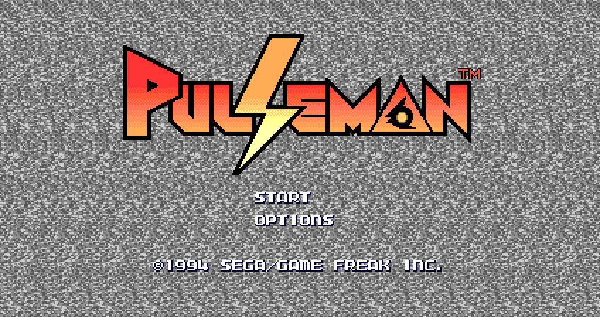
</p>

<h1 align="center">Pulseman — Recompilação para PC</h1>

<p align="center">
  <b>O clássico de 1994 da Game Freak — a mesma equipe de Pokémon — rodando nativo no Windows.</b><br>
  Widescreen, 60 fps sem lentidão, 3 arquivos de save, filtros de TV e menus em português, inglês e espanhol.
</p>

<p align="center">
  <a href="https://github.com/erikgaspar/pulseman-recomp/releases/latest"></a>
  
  <a href="LICENSE"></a>
  <a href="https://github.com/erikgaspar/pulseman-recomp/issues/new/choose"></a>
</p>

> [!IMPORTANT]
> **Este projeto não inclui nenhum arquivo do jogo original.** O instalador traz apenas o programa
> que roda o jogo no PC; todo o conteúdo do Pulseman (código, gráficos, músicas e sons) é lido da
> ROM que você fornece. Para jogar, você precisa da **ROM original do Pulseman (versão japonesa,
> sem modificações)**, obtida a partir de um cartucho que você possua.
> **Este projeto não fornece a ROM e não indica onde baixá-la.**

---

## 📸 Imagens

<p align="center">
  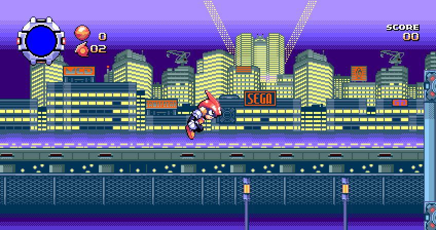<br>
  <sub>Widescreen 16:9: 52 pixels a mais de cenário de cada lado, com o HUD levado para as bordas.</sub>
</p>

| | |
|:---:|:---:|
| 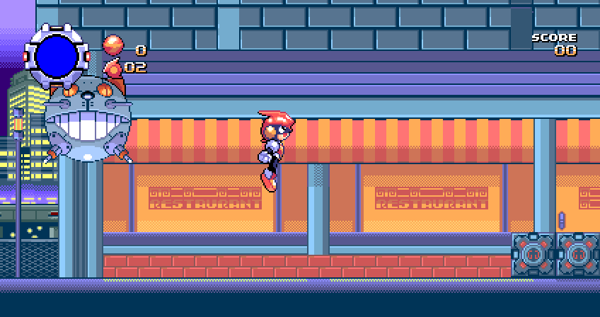 | 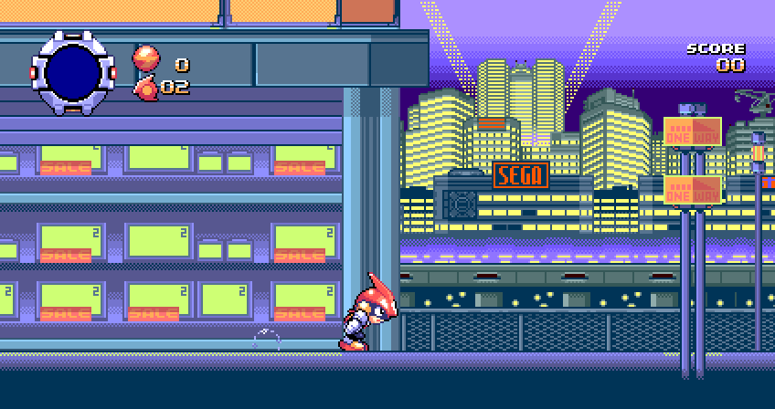 |
| A "nave gato" da primeira fase | Prédios e neon da primeira fase |
| 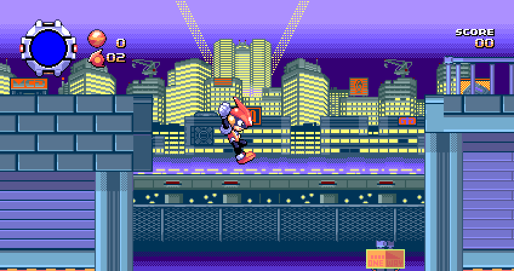 | 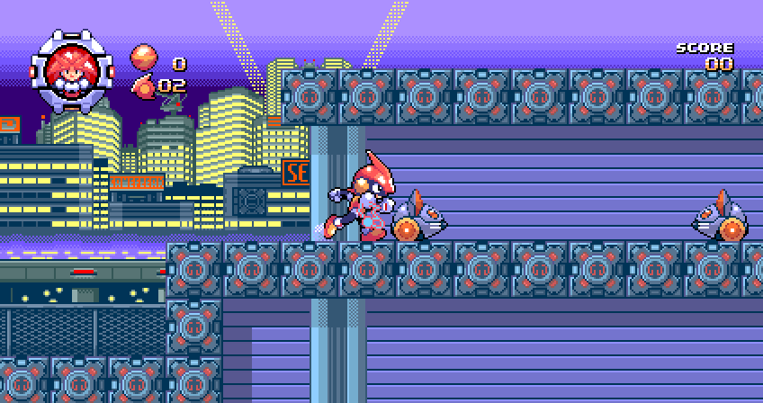 |
| A cidade ao fundo | Medidor de energia carregado (vermelho): hora do Volteccer |

<details>
<summary><b>Widescreen × modo original</b></summary>

| Widescreen (424×224) | Original (320×224) |
|:---:|:---:|
|  | 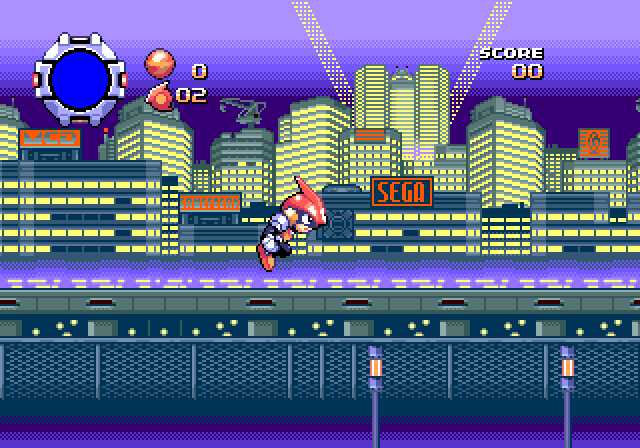 |

A área central fica idêntica ao jogo original, pixel a pixel; as colunas extras são carregadas
do próprio mapa do jogo. O modo original continua disponível no menu.
</details>

### Menus feitos para esta versão

| | |
|:---:|:---:|
| 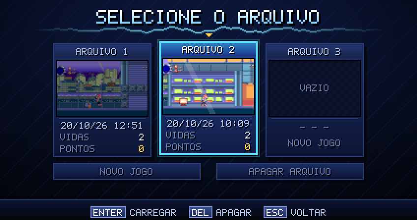 | 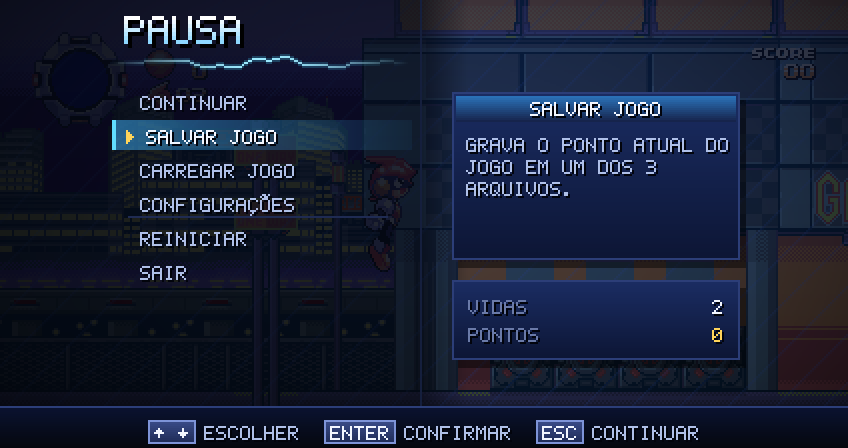 |
| Seleção de arquivos ao apertar START | Menu de pausa (Esc ou Start) |
| 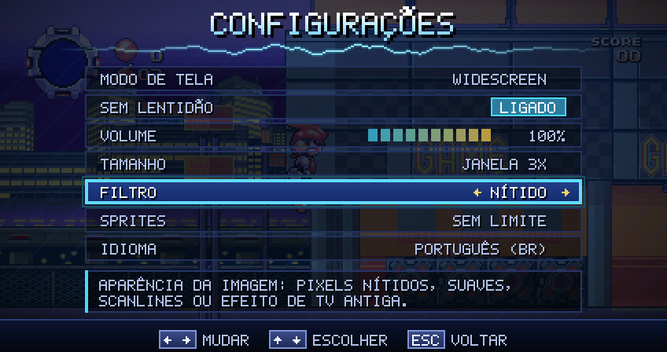 | 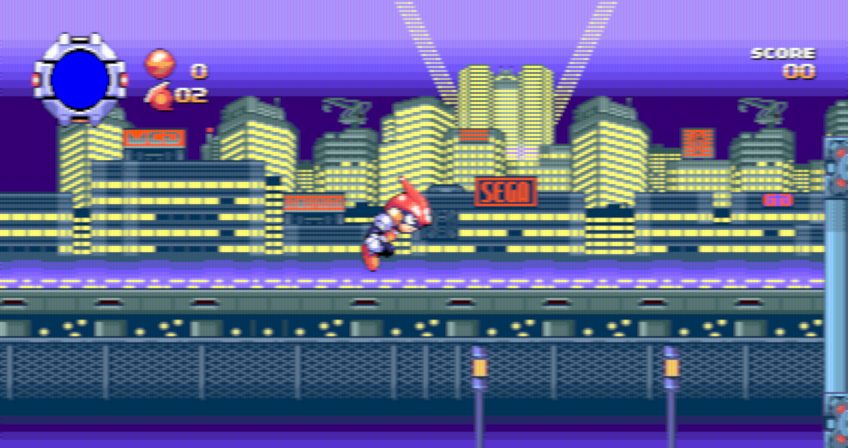 |
| Configurações com descrição de cada opção | Filtro de TV de tubo (há também scanlines e TV curva) |

### Instalador

| | |
|:---:|:---:|
| 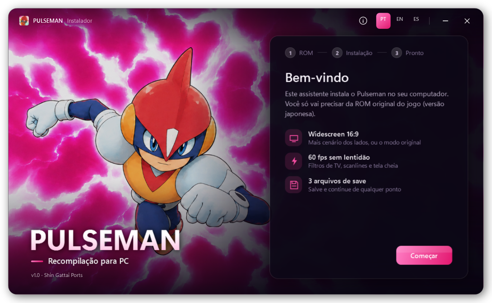 | 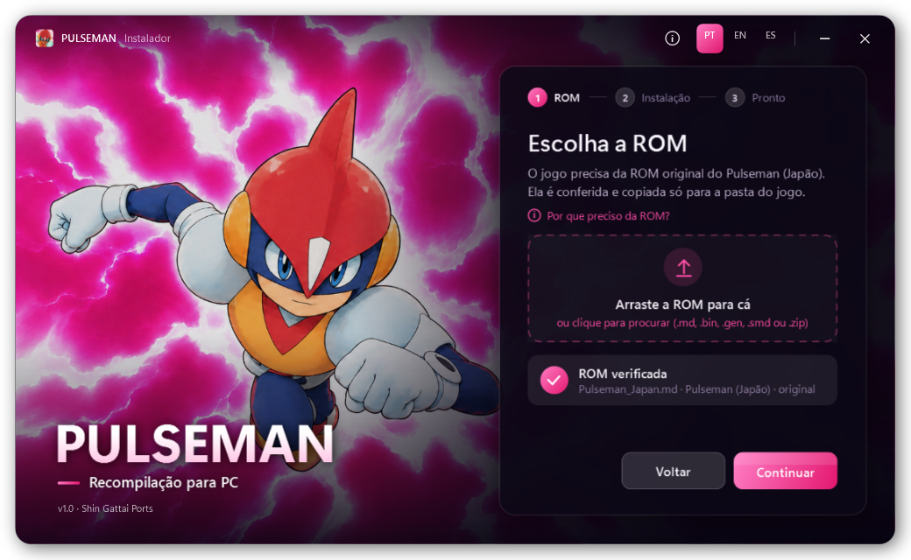 |
| Instalador | A ROM é conferida pelo SHA-1 antes de instalar |

---

## ⬇️ Como jogar

1. Baixe o **`Pulseman-Setup.exe`** na página de [**Releases**](https://github.com/erikgaspar/pulseman-recomp/releases/latest).
2. Abra o instalador. Como ele não tem assinatura digital, o Windows pode mostrar
   *"O Windows protegeu o computador"*: clique em **Mais informações → Executar assim mesmo**.
3. Arraste a sua ROM do Pulseman (Japão) para o instalador, ou clique para procurar.
   Aceita `.md`, `.bin`, `.gen`, `.smd` e `.zip`. Só a ROM japonesa original passa na conferência:

   ```
   SHA-1: 5fd76a5f80e4684b5f9d445ddb893679985684e6
   ```
4. Escolha a pasta e os atalhos, e jogue. O idioma escolhido no instalador vira o idioma dos menus.

O instalador não pede administrador (instala em `%LOCALAPPDATA%\Programs\Pulseman`), aparece em
*Aplicativos instalados* do Windows e tem desinstalador que pergunta se você quer manter os saves.

**Requisitos:** Windows 10 ou 11 (64 bits). Nada mais para instalar.

---

## ✨ O que esta versão tem

| | |
|---|---|
| 🖥️ **Widescreen 16:9** | 424×224 com o mapa carregado além das bordas originais; HUD nas bordas. Modo original (320 px) no menu. |
| ⚡ **60 fps, sem lentidão** | Um quadro por atualização do monitor e o 68000 acelerado para acabar com a lentidão do original. |
| 💾 **3 arquivos de save** | Salve e continue de qualquer ponto, com miniatura, data, vidas e pontos. |
| 📺 **Filtros** | Nítido, suave, pixel suave, scanlines, TV e TV curva. |
| 🧩 **Sprites sem limite** | Menos sprites piscando quando há muitos na mesma linha (opcional). |
| 🌎 **3 idiomas** | Menus em português, inglês e espanhol. |
| 📦 **Instalador moderno** | Confere a ROM, cria atalhos, registra no Windows e desinstala limpo. |

### 🎮 Controles

| Teclado | Mega Drive |
|---|---|
| Setas | Direcional |
| `Z` / `A` | A |
| `X` / `S` | B |
| `C` / `D` | C |
| `Enter` | Start |
| `Esc` | Menu (pausa) |

---

## 🕹️ Sobre o Pulseman

| | |
|---|---|
| **Lançamento** | 22 de julho de 1994 (Japão), Mega Drive |
| **Desenvolvimento** | Game Freak |
| **Publicação** | SEGA |
| **Gênero** | Plataforma / ação, 1 jogador |
| **Direção e design** | Ken Sugimori e Satoshi Tajiri |
| **Música** | Junichi Masuda (que também programou) |
| **Arte** | Atsuko Nishida e Motofumi Fujiwara |
| **Roteiro** | Ryousuke Taniguchi |
| **Nome de trabalho** | *Spark* |

### A história

O cientista **Doc Yoshiyama** criou uma inteligência artificial tão avançada que ganhou vida
própria: uma **C-Life** (vida de computador). Ele se apaixonou por ela e chegou a digitalizar a si
mesmo para dentro do mundo dos computadores. Dessa união nasceu **Pulseman**: metade humano,
metade C-Life, capaz de canalizar eletricidade pelo próprio corpo.

Mas viver dentro do computador corrompeu Yoshiyama, que voltou como o vilão **Doc Waruyama**.
Com o sistema **EUREKA**, que permite a seres C-Life se manifestarem no mundo humano, ele passou a
liderar a **Galaxy Gang** em ataques de ciberterrorismo. Cabe a Pulseman enfrentar o próprio pai.

### O jogo

Pulseman ataca com descargas elétricas e, ao acumular energia correndo, pode disparar o
**Volteccer**: vira uma bola de eletricidade que ricocheteia pelas paredes, destrói inimigos e
atravessa fios e circuitos para se transportar pela fase.

### Da Game Freak, a mesma equipe de Pokémon

Pulseman saiu menos de dois anos antes de **Pokémon Red & Green** (fevereiro de 1996), e boa
parte da equipe é a mesma que criou Pokémon:

- **Satoshi Tajiri**, codiretor de Pulseman, é o criador de Pokémon.
- **Ken Sugimori**, codiretor e designer, é o diretor de arte e designer dos Pokémon originais.
- **Junichi Masuda**, compositor de Pulseman, compôs as músicas de Pokémon e virou um dos nomes
  centrais da série.
- **Atsuko Nishida**, artista de Pulseman, é a designer do Pikachu.

## 💡 Curiosidades

- ⚡ **O Volt Tackle do Pikachu veio daqui.** Em japonês, o golpe se chama **ボルテッカー
  (Volteccer)**, o mesmo nome do golpe de Pulseman. Em *Super Smash Bros. Brawl*, o Volt Tackle do
  Pikachu também lembra o Volteccer no visual e nos controles.
- 🇯🇵 **Nunca saiu em cartucho fora do Japão.** Nos Estados Unidos ele só apareceu em 1995 pelo
  **Sega Channel**, o serviço de jogos por TV a cabo do Mega Drive/Genesis.
- 🔁 **Relançamentos:** Virtual Console do Wii (Japão em 2007; América do Norte e Europa em 2009)
  e a biblioteca de Mega Drive do Nintendo Switch Online (2023).
- 📰 **Recepção:** no Virtual Console, ganhou 8/10 da IGN e da Nintendo Life. Em outubro de 1994,
  a *Micom BASIC Magazine* o colocou em 8º lugar de popularidade no Japão.
- 🏙️ **Os cenários estão cheios de placas** (inclusive da própria SEGA, em neon), como numa cidade
  dos anos 90 vista de dentro do computador.

<sub>Fontes: <a href="https://en.wikipedia.org/wiki/Pulseman">Wikipedia (Pulseman)</a>,
<a href="https://www.nintendolife.com/games/megadrive/pulseman/review">Nintendo Life</a>,
<a href="https://supersmashbros.fandom.com/wiki/Volt_Tackle">Super Smash Bros. Wiki (Volt Tackle)</a>.</sub>

---

## 🛠️ Como funciona

Este projeto começou como uma **recompilação estática**: o código 68000 da ROM é traduzido para C
no build, e uma camada emula só o hardware (VDP, controles, Z80, YM2612 e PSG). Para conferir a
tradução, um modo *lockstep* roda cada bloco recompilado e o mesmo trecho num interpretador e
compara o resultado.

A **versão distribuída** (a do instalador) não tem nada gerado a partir da ROM: o código do jogo
roda num interpretador de 68000 direto da ROM do jogador, e as melhorias deste projeto (widescreen,
menus, saves, filtros) entram por cima. Partindo do mesmo save, as duas versões ficam idênticas.

Detalhes, formato dos arquivos e opções de teste: [**docs/TECNICO.md**](docs/TECNICO.md).

### Compilar

Precisa de Visual Studio 2019 ou mais novo (C/C++), Python 3.9+ e PowerShell.

```powershell
# baixa o CMake portátil e o SDL2 para tools/
powershell -ExecutionPolicy Bypass -File tools/baixar_dependencias.ps1

# versão distribuível (não precisa da ROM)
tools/cmake-3.30.5-windows-x86_64/bin/cmake -S . -B build_dist -G "Visual Studio 16 2019" -A x64 -DPM_ROM=nenhuma
tools/cmake-3.30.5-windows-x86_64/bin/cmake --build build_dist --config Release

# instalador (build/installer/Pulseman-Setup.exe)
powershell -ExecutionPolicy Bypass -File installer/build.ps1
```

Com a ROM em `../Pulseman_Japan.md`, o build normal (`-B build`) também gera a versão recompilada e
o lockstep.

---

## 🐞 Encontrou um bug?

Abra uma [**issue de bug**](https://github.com/erikgaspar/pulseman-recomp/issues/new?template=bug_report.yml).
O formulário pede o que for preciso para reproduzir o problema. O que mais ajuda:

- **um save de logo antes do problema** (`pulseman-slot1.sav` a `pulseman-slot3.sav`, na pasta do
  jogo). Com ele dá para repetir exatamente a mesma situação;
- o modo de tela (widescreen ou original), em que fase e o que você fez.

Por favor, **não anexe a ROM nem peça onde conseguir uma**: issues assim são fechadas.

Ideias e sugestões são bem-vindas também, pelo [formulário de sugestão](https://github.com/erikgaspar/pulseman-recomp/issues/new?template=feature_request.yml).

---

## 🙏 Créditos

- **Pulseman** © 1994 SEGA / Game Freak. Este projeto não tem ligação com a SEGA nem com a Game Freak.
- **Shin Gattai Ports**: recompilação, runtime, widescreen, menus, instalador.
- [Musashi](https://github.com/kstenerud/Musashi) (Karl Stenerud, MIT): interpretador de 68000.
- [ymfm](https://github.com/aaronsgiles/ymfm) (Aaron Giles, BSD-3): YM2612.
- [z80](https://github.com/superzazu/z80) (Nicolas Allemand, MIT): Z80.
- [SDL2](https://libsdl.org) (zlib): janela, áudio e entrada.

Licenças completas em [THIRD_PARTY.md](THIRD_PARTY.md).

## 📜 Licença e aviso legal

O código deste projeto está sob a [licença MIT](LICENSE). Ela vale **só para o código deste
repositório**: Pulseman, seus personagens, gráficos e músicas pertencem aos seus donos. Nenhum
arquivo do jogo é distribuído aqui, e este projeto não fornece nem indica onde obter a ROM.

---

<details>
<summary>🇺🇸 <b>English summary</b></summary>

**Pulseman PC** is a native Windows port of *Pulseman* (1994, Mega Drive), developed by
**Game Freak** (the studio behind Pokémon) and published by SEGA. It adds 16:9 widescreen,
60 fps with no slowdown, 3 save files, CRT/scanline filters and menus in Portuguese, English and
Spanish, and ships with a modern installer.

**No game files are included.** You need your own original, unmodified **Japanese Pulseman ROM**
(SHA-1 `5fd76a5f80e4684b5f9d445ddb893679985684e6`), dumped from a cartridge you own.
This project does not provide the ROM and does not say where to download it.

Download the installer from [Releases](https://github.com/erikgaspar/pulseman-recomp/releases/latest),
report bugs through the [bug report form](https://github.com/erikgaspar/pulseman-recomp/issues/new?template=bug_report.yml).

Fun fact: Pikachu's **Volt Tackle** is called **Volteccer** in Japanese, after Pulseman's move.
</details>
